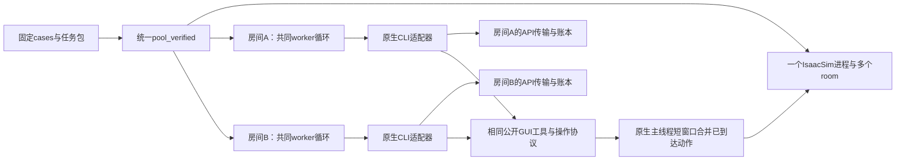

# VideoICL 具身评测完整交接

本文面向接手数据分析和复现实验的同学。题目、模型输入、执行轨迹和代码均可通过下面的公开链接下载。查看视频、文字、动作、步数和分数可在自己的电脑完成。

本次快照交付 150 组题目材料、1,237 条已封存回合的完整留存原图、完整观察回放与模型输入文字。两条未完成 GLM 回合在索引中预留，待后续补充。

文档更新：2026-11-12。数据统计对应 **2026-11-11 发布快照**；最新统一代码对应 **2026-11-12 的 `0956988`**。文中的“待补”描述该固定数据版本，不是对服务器当前状态的实时查询。

## 阅读顺序

| 接手目标 | 建议顺序 |
| --- | --- |
| 只看题目、示范和模型输入 | 下载入口 → 题目与实验定义 → 查看一题 → 模型实际输入 → 离线下载。 |
| 做结果统计或案例分析 | 实验定义 → 执行轨迹 → 分数与用量口径 → 分析示例 → 固定版本。 |
| 在新机器跑实验 | 统一 Harness 架构 → 配置表 → 新机器准备 → 任务与 cases → 启动与回收 → 验证范围。 |

本文区分三类材料：`tasks/` 是作者构造的题目与 ABC 材料；`evaluation/` 是已经执行实验的固定配置；`model_inputs/` 与轨迹库是每个模型实际留存的输入和输出证据。复核一条结果时，以固定回合的配置和原生证据关联三者。

### 目录

- [下载入口](#下载入口)
- [题目、环境和实验定义](#题目环境和实验定义)
- [先查看一题](#先查看一题)
- [模型实际输入与交互循环](#查模型实际收到的内容)
- [执行轨迹、字段与评分口径](#查执行轨迹)
- [固定数据快照统计](#实验与进度)
- [下载到自己的电脑](#下载到自己的电脑)
- [离线分析示例](#离线分析示例)
- [最新统一代码入口](#最新统一代码入口)
- [新机器准备](#新机器准备先数据后gpu与模型)
- [任务包和cases绑定](#任务包和cases如何绑定)
- [配置检查与启动](#配置预检查诊断和正式请求的顺序)
- [运行监测、停止与回收](#运行中看哪些文件怎样停止和回收)
- [验证范围与排查](#验证范围与排查入口)
- [固定版本](#本次交付的固定版本)
- [50题浏览索引](#附50题浏览索引)

## 下载入口

| 内容 | 公开入口 | 主要文件 |
| --- | --- | --- |
| 50 题 A/B/C、消音 real/sim、prompt 和文字规则 | [Demo 与输入数据集](https://huggingface.co/datasets/JJimmyL/VideoICL-Embodied-Demos50) | `TASK_INDEX.md`、`tasks/`、`archives/` |
| 实际评测输入与每个模型保存的文字上下文 | [固定评测输入](https://huggingface.co/datasets/JJimmyL/VideoICL-Embodied-Demos50/tree/main/evaluation) · [模型输入](https://huggingface.co/datasets/JJimmyL/VideoICL-Embodied-Demos50/tree/main/model_inputs) | `assignments.jsonl`、`cases/`、`model_inputs/`、`input_archives/` |
| 六模型执行轨迹、步数、分数、完整观察视频和原图 | [轨迹数据集](https://huggingface.co/datasets/JJimmyL/VideoICL-Embodied-Evaluation-Trajectories-Public) | `episodes.csv`、`episodes.parquet`、`full_observations/`、`full_replays/` |
| 机器人、场景、USD、纹理与物体资产 | [仿真资产数据集](https://huggingface.co/datasets/JJimmyL/VideoICL-Embodied-Handoff-20261103) | `full50-current/`、`g2-ur5-v1/` |
| 代码与运行说明 | [main/simulator](https://github.com/Aoraku/VideoICLBench/tree/main/simulator) | [当前 Harness](harness/coalesced/README.md) · [Harness 导航](harness/README.md) |

## 题目、环境和实验定义

### 50 题、A/B/C 与 R/I/E

- `E01`–`E50` 是任务编号。每题 A/B/C 是该任务的三种局部规则版本，不是三个模型或三个环境。
- 主表固定 C；ABC 消融才新增 A、B 的指定视频条件。同题不同规则需要分别统计。
- `R` 是按源视频复现的场景；`I` 在对应原环境中实际更换物体实例，保留要学的规则；`E` 使用新建环境及其指定绑定。位姿随机变化不能代替 I 的物体替换。
- R/I/E 与更早工程测试的 G0/G1/G2 命名不要直接混用。判断机器人、桌面、物体实例与摄像机配置，读取该回合的 `bindings`、`robot` 和运行时来源。
- 当前材料的环境支持目录分别列 R 45题、I 42题、E 50题。**支持清单不等于实际已经跑过的笛卡尔积**；真正运行范围由 `evaluation/assignments.jsonl` 固定。
- 主表每模型 50题 × text/real。42题使用 I，8题回退 R：`E12 E29 E37 E44 E47 E48 E49 E50`。

输入条件统一为 `text_rule`、`real`、`sim`、`none`。轨迹目录里对应 `text`、`real`、`sim`、`no-rule`。text 提供任务指令和指定规则；视频条件提供任务指令和指定视频；none 只保留该条件任务目标。所有物理条件在执行阶段都可观察机器人 GUI，text 不代表没有视觉观察。

示范揭示的是指定规则。当前任务指令可能还要求订单处理、包装、转移与交付，不能把旧视频中局部动作的完成直接视为整题完成。按回合 `instruction.md` 判断完整目标。

### 实验之间如何去重

所有实验共享同一组17题：

```text
E30 E33 E15 E24 E16 E27 E06 E21 E31
E47 E01 E23 E46 E50 E20 E19 E09
```

| 实验 | 配置与新增量 | 每模型累计唯一物理回合 |
| --- | --- | ---: |
| 主表 | 50题固定C × text/real，100条。 | 100 |
| 同17题泛化 | 支持的R/I/E × text/real共92个配置；其中34条复用主表，只新增58条。 | 158 |
| sim示范条件 | 同17题支持的R/I/E × sim，新增46条。 | 204 |
| ABC规则条件 | 同17题real视频新增A/B，共34条，C复用。 | 238 |
| 无规则输入 | 同17题指定配置，新增17条。 | 255 |
| 独立视频QA | 同17题 × ABC，共51次；不创建物理episode。 | 单独统计 |

Astra、DeepSeek、GLM各255个固定物理身份，Opus、Kimi、Qwen各158个，合计1,239。Astra有1条明确复用的先导回合，因此它的255条不是255次全新启动。复用身份以元数据为准，不能补启动一个相同配置来“凑数”。

`experiments` 可能同时包含多个表的归属。按表筛选时一条回合可以进入多个表；计算总执行量时按模型与固定物理身份去重。

### 独立QA的规则

题库共有50道四选一问题；当前实验只取固定17题的ABC视频，得到51个QA配置。Astra、DeepSeek、GLM各51次，结果库共153个首答。QA通过 `demo_info`、`demo_frames` 看视频，调用 `qa_question` 取题，再通过 `qa_answer` 提交首个有效选项。物理评测本身不再追加QA。

`evaluation/qa_questions.jsonl` 保存模型可见题干、选项、回答要求与指定视频；`author_qa_answers.jsonl` 是作者离线判分材料。标准答案和物理评分规则在控制端保存，不应装入模型工作区。QA正误从结果库读取，不能从最后一段自然语言自行猜测。

## 先查看一题

打开 Demo 数据集的 `TASK_INDEX.md`，选择任务和 A/B/C 规则版本。例如 `tasks/E01/C/` 下有以下文件。

| 文件 | 内容 |
| --- | --- |
| `real.mp4` | 真实示范，无音轨，H264。 |
| `sim.mp4` | 对应规则的仿真示范，无音轨，H264。 |
| `prompt.md` | 题目目标与作者设计的完整执行目标。 |
| `text_rule.md` | text 输入使用的 A/B/C 局部规则。 |
| `task.json` | 规则、任务构造、环境支持、评分设计、视频来源和哈希。 |

共 150 组材料、150 段 real 和 150 段 sim。真实示范从源 HEVC 转为便于浏览的 H264，校验帧数、方向、时长与零音轨。仿真示范保留 H264 视频流并去音轨。E37 的三段仿真示范使用后补固定版本，来源记录在各 `task.json` 中。

HF 查看器的 `task_catalog` 配置直接显示 `prompt_text` 与 `text_context` 正文；`model_inputs` 配置直接显示逐回合 `initial_prompt_text`。也可下载对应 Markdown 阅读。

`archives/` 按每十题打包，解压后得到同样的目录。逐文件 SHA-256 见 `FILE_MANIFEST.jsonl`，压缩包校验信息见 `ARCHIVES.json`。

### Demo 与输入库目录图

```text
VideoICL-Embodied-Demos50/
├── TASK_INDEX.md                 # 50题ABC导航
├── catalog.jsonl                # 150组题目，含prompt/text正文及媒体索引
├── tasks/E01/A/                 # 每组5个文件：2视频、prompt、rule、task.json
├── archives/                    # 每10题一个离线任务包
├── evaluation/
│   ├── assignments.jsonl        # 255个固定物理配置
│   ├── cases/<episode_id>/      # 实际instruction、case、text rule
│   ├── media/                   # 实际固定输入的101段消音发布视频
│   ├── qa_questions.jsonl       # 51个独立QA配置
│   ├── question_bank50.json     # 50题题库
│   └── author_qa_answers.jsonl  # 仅供离线判分
├── environments/                # R/I/E支持范围
├── prompt_templates/            # 版本化模型/工具说明与QA模板
├── MODEL_INPUT_INDEX.csv        # 逐模型、逐回合输入路径及覆盖
├── model_inputs/<canonical>/    # 每模型留存的初始输入与公开上下文
├── input_archives/              # 逐模型分片和全量文字输入包
└── downloads/                   # 固定输入包、文字模板包
```

`FILE_MANIFEST.jsonl` 覆盖题目材料，不是整个数据集全部文件的单一清单。`ARCHIVES.json` 对应任务包，`evaluation/video_manifest.jsonl` 对应实际输入视频；逐回合消息另有自己的来源哈希和覆盖文件。

## 查模型实际收到的内容

`evaluation/assignments.jsonl` 固定 255 个物理配置，含 task、variant、R/I/E、seed、输入模式和实验归属。每个 `evaluation/cases/<episode_id>/` 单独提供可读的 `instruction.md` 和 `case.json`。text 条件另有 `text_rule.md`。该目录保留当次评测的环境附加目标和任务指令。

`evaluation/media/` 提供实际输入视频的 101 段消音发布版。每段记录发布文件 SHA-256，以及原评测文件的 `evaluated_input_sha256`。`downloads/fixed-evaluation-inputs.tar.gz` 一次下载固定配置、文字和视频。

`model_inputs/<model>/<experiment>/<task>/<case>/` 对应一个模型的物理回合，包含以下输入记录。

| 文件 | 内容 |
| --- | --- |
| `initial_user_prompt.txt` | 宿主保存的初始任务 prompt，包含该模式的任务、文字规则、示范元信息和初始公开状态。 |
| `worker_instruction_fragments.json` | 已保存 worker 中可溯源的附加指令和版本信息。 |
| `public_context.jsonl` | 按序保存模型主动观察、动作执行、历史、深度查询等工具产生的公开文字上下文，图像以哈希关联。 |
| `first_recorded_user_message.json` | 从该回合原生会话记录提取的首条实际 user 消息。 |
| `native_input_messages.jsonl` | 原生会话中已保存的 user、system、developer、tool 输入记录。 |
| `native_conversation_messages.jsonl` | 另保留可见 assistant 文字、工具调用和公开会话输入，便于查看后续请求所用的对话历史。 |
| `native_conversation_coverage.json` | 对话投影的日志来源、重复记录与顺序说明。 |
| `input.json`、`native_input_coverage.json` | 输入来源、公开配置、源日志 SHA-256、记录数量与覆盖范围。 |

原生记录的首条 user 消息可能是 CLI 自动加入的环境说明，后续任务正文和工具返回按 `source_record_index` 保留在 `native_input_messages.jsonl` 中。

宿主 prompt 后可能追加 worker 指令，原生 CLI 还会生成系统内容与 compact 上下文。各文件按实际留存范围记录来源。公开对话投影保留来源文件和记录序号，不能直接拼成每次请求的精确 wire 内容。`public_context` 留存全部公开工具事件，不代表每次请求都发送全部事件；Token 用量应读取提供方请求用量，不能直接相加会话记录的文字长度。复现时同时记录模型、CLI 版本、工具定义、窗口和 compact 配置，具体参数见对应 Harness 和回合元数据。

`MODEL_INPUT_INDEX.csv` 和 `MODEL_INPUT_INDEX.jsonl` 按模型、题目和逻辑回合列出 prompt、原生输入消息、公开上下文与覆盖文件的直接路径。`prompt_templates/standalone-qa/` 另有独立视频 QA 的首轮文字、工具说明和窗口设置。

`downloads/prompts-and-context-templates.tar.gz` 打包题目 prompt、text 规则、固定评测指令、QA 题目与 Harness 模型/工具文字。`input_archives/all-saved-model-inputs.tar.gz` 一次下载所有已封存回合留存的模型输入文字和公开对话历史。其余分片包按模型和回合组织，解压到同一 `model_inputs/` 目录。使用文字模式时把 `instruction` 与对应 `text_rule` 作为输入。视频模式使用指令和指定 real/sim 视频。none 模式使用该条件下的任务指令。

### 首轮、动作轮和主动读取分别发什么

当前统一入口的模型可见交互流程为：

1. 控制端固定 task/variant/environment/seed 与输入条件，创建房间身份，加载物体和机器人；初始状态与摄像机读回完成后才开放模型执行。
2. 首轮提供任务指令、该条件允许的规则或示范信息、公开初始状态。Codex/Claude Code配置还负责注入同一组模型与工具说明，初始完整GUI只按首轮附图路径提供。其他CLI按其适配流程通过 `observe` 取得初图。
3. 模型用 `action_batch` 指定一个动作序列和唯一 `operation_id`。序列中的平移、转动、抓取、释放经原有GUI/控制面提交，Commit后仿真执行并返回动作回执和更新GUI。
4. 模型继续决策。需要额外观察时调用 `observe`；看示范、历史或深度时显式调用对应工具。纯demo/depth读取不会自动附带一份未变化的当前GUI。
5. 模型调用 `done` 或 `giveup` 后，宿主仍要核对原生终态、评分与API排空，再关闭该回合。模型说“完成了”只是模型判断。

GUI为1440×1280的完整操作界面，包含保留的三路相机小窗和公开状态。完整GUI并不等于三张独立全尺寸RGB图像同时输入。传输格式可能因CLI限制使用不同图片编码；例如GLM路径保存图像编码账本。空间分辨率、传输字节及原图应分别查证。

当前 `action_batch` 工具schema一次接受1–24个左右臂动作对；这是每次工具调用的序列容量，**没有“每次最多4个动作”的限制**。一题可以继续提交多个batch，500上限按原生确认的物理动作计数；API请求数、工具调用数、batch数和物理动作数不同。

| 工具 | 作用与边界 |
| --- | --- |
| `observe` | 主动读取当前GUI和公开机器人状态，不推进一个新物理动作。 |
| `action_batch` | 提交按序的左右臂动作对，一次Commit，执行后返回回执和最新GUI。 |
| `depth_points` | 对当前公开相机图上模型选择的1–16个 `[row,col]` 像素读原生深度及校准信息。 |
| `demo_frames` | 仅视频条件开放，按指定时间点读取本回合分配的示范；不是浏览任意任务的视频。 |
| `history` | 读取本回合已留存的公开事件，可按需附历史图像，不访问其他回合或私有状态。 |
| `done` / `giveup` | 经原GUI提交终态意图；最终封存和成绩仍以原生证据为准。 |

动作 `operation_id` 必须稳定且唯一。相同ID读取已完成结果时返回缓存回执，不会重新执行；同ID换一组动作会被拒绝。已接受但结果不明的动作先保留现场核对，不能通过新ID重发同一动作。缓存回执也不等于当前世界的新观察。

### 历史、compact 与Token

对话历史与压缩由各原生CLI管理。`history` 是模型主动查阅公开事件的工具，不等同于宿主每轮把磁盘里的全部历史文件重新喂给模型。窗口容量、压缩触发阈值、已使用上下文长度和累计input是四个不同数值。

累计input会把每次请求携带的历史重复计入。例如100次请求平均各带10万token，累计input就是1,000万，即使最后上下文只有十几万。计费应区分未缓存输入、缓存读取、缓存写入和输出；不能用“1M窗口 × 回合数”估计总费用，也不能把缓存input加到已经包含它的input上。

留存输入是可审计的公开投影：日志镜像、重新记录、跨源文件条目可能重复。它可以说明模型看过哪些公开内容，但不能直接当作逐请求完整body重放。CLI未保存的动态系统/压缩内容按coverage标为未知；隐藏推理与凭据不发布。

## 查执行轨迹

先下载 `episodes.csv`，即可查看模型、题号、A/B/C、环境、输入模式、步数、原生成功与工程分。JSONL 适合逐行处理，Parquet 适合 pandas/Arrow。表间共用回合通过 `logical_episode_id` 和模型关联，`experiments` 记录归属。跨模型比较使用 `task_id`、`variant`、`environment`、`input`、`seed` 共同匹配，逻辑 ID 的批次前缀可能不同。

每个回合的基础目录采用 `<model>/<experiment>/<task>/<variant>-<environment>-<input>-s<seed>/`。

| 文件或索引 | 内容 |
| --- | --- |
| `episode.json` | 回合身份、终态原因、分数来源、动作数、媒体引用和哈希。 |
| `actions.jsonl.gz` | 完整已确认动作及原生回执，step 从 1 连续到动作总数。 |
| `final_head.jpg`、`final_left_wrist.jpg`、`final_right_wrist.jpg` | 封存时三路相机图像。 |
| `observations.mp4` | 便于快速浏览的采样观察回放。 |
| `observations.jsonl`、`frames.zip` | 采样回放的步数映射与可解包帧。 |
| `supplement.json` | 原生耗时、墙钟时间、基础设施等待、请求用量、完整帧数量和大文件归档引用。 |
| `full_replays/` | 使用全部已保存 GUI 事件生成的原尺寸无音视频。 |
| `full_observations/` | 完整原图、公开事件、原生终态条件和逐请求用量的分片归档。 |

完整归档内，`original_images/` 保留原 PNG/JPEG 字节和逐图哈希，`public_events.jsonl` 关联观察、动作和深度等公开工具数据。`native_conditions.json` 保存原生终态条件，`terminal.json` 保存步数和各类耗时，`api_requests.jsonl` 保存已记录请求的用量字段。`FILES.jsonl` 校验包内文件，`COVERAGE.jsonl` 给出每条回合的覆盖信息。

观察视频按 4 fps 回放保存的观察事件，播放时长由帧数决定。实际运行耗时在终态元数据中。动作之间的物理过程按当时保存的材料提供。

`native_success` 保留原生回执的 success 值，`score_100` 是记录的工程分，`score_source` 标明来源。几何验收的验证状态按各原生条件文件保留，工程分不直接等同于正式验收。缺分为 `null`。Token 字段保留提供方原始名称，缓存计数及可用请求范围在 `api_usage` 中注明。Astra 与 Opus 的原生 CLI 逐回合补充审计在 `cli_usage/`，索引中的 `audited_*` 列使用去重响应的小计，不把累计计数再次相加；没有保存用量的请求计费仍为未知。

### 轨迹目录和字段解释

```text
VideoICL-Embodied-Evaluation-Trajectories-Public/
├── episodes.csv / episodes.jsonl / episodes.parquet
├── qa.parquet / qa.jsonl
├── astra|opus|deepseek|glm|kimi|qwen/
│   └── <experiment>/<task>/<case>/
│       ├── episode.json
│       ├── actions.jsonl.gz
│       ├── observations.mp4 / observations.jsonl / frames.zip
│       ├── final_head.jpg / final_left_wrist.jpg / final_right_wrist.jpg
│       └── supplement.json
├── full_replays/<canonical>/observations_full.mp4
├── full_observations/<model>/*.tar.gz
│   ├── manifest.jsonl          # 位于full_observations根，索引分片
│   └── README.md
└── cli_usage/                  # Astra/Opus补充去重请求用量
```

上图目录中的可用文件以逐回合索引为准。`observations.mp4` 是最多45帧的快速采样预览；`observations_full.mp4` 才是全部留存GUI事件的回放。原图包还可能包含demo/history返回的图片，因此 `original_images` 可以超过GUI回放帧数。

| 字段 | 如何读取 |
| --- | --- |
| `logical_episode_id` + `model` | 同模型内部去重与关联输入/轨迹。 |
| `task_id, variant, environment, input, seed` | 跨模型匹配同一配置的键。 |
| `experiments` / `canonical_experiment` | 所属实验列表 / 唯一实际存储目录归属。 |
| `native_terminal` | 有可核对原生终态；不同于“进程已退出”。 |
| `native_success` | 原生记录的success，不由API是否200或模型措辞决定。 |
| `score_100` / `score_source` | 工程分及来源；`null`与真实0分必须区分。 |
| `termination_reason` / `artifact_status` | 终止原因与归档覆盖。 |
| `actions` | 已确认物理动作总数；用动作回执核对，不按请求数替代。 |
| `effective_seconds` | 原生有效耗时，保留源字段elapsed_seconds的含义。 |
| `wall_seconds` / `infrastructure_wait_seconds` | 墙钟时间 / 已识别的基础设施等待；不要用4fps视频时长替代。 |
| `full_archive_path, full_archive_sha256` | 该回合完整原图与公开事件所在分片及SHA-256。 |
| `full_replay_path, full_replay_frames` | 完整GUI事件视频和实际帧数。 |
| `api_usage_fields, api_usage_coverage` | 提供方原字段及已记录范围；CSV里的结构字段可能是JSON字符串。 |
| `audited_*` | Astra/Opus的额外去重响应审计小计；缺失字段仍为空。 |

### 分数、成功率和用量的统计口径

- 原生终态可以是成功，也可以是正常giveup或动作上限终止。终态数不等于成功数。
- 有终态仍可能没有可用工程分。报告时分别列总身份、终态数、原生成功数、有分数、空分数和均分分母。
- 保存的 `score_100=0` 是有效数值；缺证据或未评分保持 `null`，不能填0后算平均。
- 这里的分数包含过程/几何判定，验证状态在 `native_conditions.json` 等来源里。已知历史E33容器、E08入盒等问题应从末态几何与条件复核，不能仅凭画面或Done文本改分；任何重评必须另记版本和依据。
- 跨模型汇总必须选择相同实验和相同配置交集。255条全消融的均分与158条主表+泛化的均分不能直接当成公平排名。
- 提供方用量字段的cached/read/write/reasoning语义可能不同。output包含reasoning时，不把reasoning再加一次。总用量审计还需说明失败请求是否报告usage、原生compact是否包含、历史复用来源和缓存口径。
- `cli_usage/` 的Astra与Opus总量是已报告、已去重响应小计；无usage的请求计费未知。价格应单独固定模型和官方价目表日期，本数据快照不把历史估价当成当前价格。

## 实验与进度

主表用 50 题固定 C，每题 text 和 real 各一次，共 100 条。泛化使用同一组 17 题，支持的 R/I/E 与 text/real 配置共 92 条，其中 34 条复用主表，去重后每模型 158 条。完整消融另加 sim 46 条、A/B 视频 34 条、none 17 条，共 255 条。

R 为按视频复现的场景，I 更换物体，E 使用新环境。支持范围见 Demo 数据集的 `environments/`，实际配置见固定清单。

| 模型 | 原生终态 / 固定物理回合 | 原生成功 | 有工程分 | 已评分子集平均 / 100 |
| --- | ---: | ---: | ---: | ---: |
| Astra | 255 / 255 | 59 | 255 | 28.471 |
| Opus 5.5 | 158 / 158 | 42 | 158 | 34.378 |
| DeepSeek Flash 1017 | 255 / 255 | 19 | 222 | 13.243 |
| GLM-5.3-Flash | 253 / 255 | 9 | 226 | 8.789 |
| Kimi K3 | 158 / 158 | 0 | 152 | 2.862 |
| Qwen3.8-Max | 158 / 158 | 8 | 141 | 10.461 |

表中均分只使用该模型已经记录工程分的回合。模型实验范围和缺分数量不同；这张表用于交接核数，模型对比需按相同任务和条件取交集。

完整原图共 44,655 张，完整原始观察归档共 54 个分片，独立完整 GUI 事件回放 1,237 段。留存原生输入消息为 66,316 条，公开对话投影为 230,337 条。投影可能含原日志镜像条目，不是API请求数。

本次交付快照有 1,237 条原生终态，GLM E41C-I-text 与 E45C-I-text 两条待补。独立视频 QA 共 153 个首答，保存在轨迹库的 `qa.parquet` 与 `qa.jsonl`。题库和作者答案放在 Demo 库，模型首答与判分放在结果库。

## 下载到自己的电脑

安装 `huggingface_hub` 后可使用以下命令，公开材料可匿名读取。

```bash
python3 -m pip install huggingface_hub
hf download JJimmyL/VideoICL-Embodied-Demos50 --repo-type dataset \
  --revision 6850489d7886334cb0d463f08ceb9eea461227bd \
  --local-dir ./videoicl-inputs
hf download JJimmyL/VideoICL-Embodied-Evaluation-Trajectories-Public --repo-type dataset \
  --revision 0a84cd0305240eb98512b71e429ac9f0a6e9f304 \
  episodes.csv episodes.jsonl episodes.parquet qa.parquet README.md \
  --local-dir ./videoicl-trajectories
```

只查看模型输入文字时，可先下载索引与单个文字包。

```bash
hf download JJimmyL/VideoICL-Embodied-Demos50 --repo-type dataset \
  --revision 6850489d7886334cb0d463f08ceb9eea461227bd \
  MODEL_INPUT_INDEX.csv input_archives/all-saved-model-inputs.tar.gz \
  downloads/prompts-and-context-templates.tar.gz \
  --local-dir ./videoicl-inputs
tar -xzf ./videoicl-inputs/input_archives/all-saved-model-inputs.tar.gz \
  -C ./videoicl-inputs
```

再把 `downloads/prompts-and-context-templates.tar.gz` 解压到同一目录，即可同时查看题目文字和 Harness 文字模板。

先读轨迹索引，按回合的归档和视频引用下载所需文件。HF 的 `full_observations/README.md` 列出分片与大小，避免一次下载所有原图。离线解包后可直接用播放器和文本编辑器查看。

## 离线分析示例

下面示例读取固定发布的JSONL，不需要GPU、API密钥或服务器登录。`logical_episode_id`的批次前缀不用于跨模型join。

```python
import json
from collections import defaultdict
from pathlib import Path
from statistics import mean

rows = [json.loads(line) for line in
        Path("videoicl-trajectories/episodes.jsonl").read_text().splitlines()]
by_model = defaultdict(list)
for row in rows:
    by_model[row["model"]].append(row)
for model, group in sorted(by_model.items()):
    terminal = [r for r in group if r["native_terminal"] is True]
    scored = [r["score_100"] for r in terminal if r["score_100"] is not None]
    print(model, {"fixed": len(group), "terminal": len(terminal),
          "success": sum(r["native_success"] is True for r in terminal),
          "scored": len(scored), "mean_scored": mean(scored) if scored else None})

# 在所有模型主表的“都有分”配置交集上比较，另外报告交集大小。
keys = ("task_id", "variant", "environment", "input", "seed")
main = {model: {tuple(r[k] for k in keys): r for r in group
               if "main" in r["experiments"] and r["native_terminal"] is True
               and r["score_100"] is not None}
        for model, group in by_model.items()}
common = set.intersection(*(set(group) for group in main.values()))
print("common scored main configurations", len(common))
for model, group in sorted(main.items()):
    print(model, mean(group[k]["score_100"] for k in common) if common else None)
```

复核具体回合时，先用 `episode_path` 看身份和终态，再顺着 `trajectory_path` 查动作、`full_replay_path` 看完整回放、`full_archive_path` 解包原图与条件。对应输入从Demo库的 `MODEL_INPUT_INDEX.jsonl` 按模型和 `logical_episode_id` 查找。

```python
# 下载指定原图分片并校验整个分片SHA；相对路径来自上面的episodes索引。
import hashlib
from huggingface_hub import hf_hub_download

sample = next(r for r in rows if r["model"] == "astra" and r["native_terminal"])
archive = Path(hf_hub_download(
    "JJimmyL/VideoICL-Embodied-Evaluation-Trajectories-Public",
    sample["full_archive_path"], repo_type="dataset",
    revision="0a84cd0305240eb98512b71e429ac9f0a6e9f304", token=False))
h = hashlib.sha256()
with archive.open("rb") as stream:
    for block in iter(lambda: stream.read(1024 * 1024), b""):
        h.update(block)
assert h.hexdigest() == sample["full_archive_sha256"]
print(archive)
```

用 `tar -tzf <分片>` 看目录，再解压到自己的新目录。包内 `FILES.jsonl` 保存成员路径/大小/哈希，`COVERAGE.jsonl` 提供回合覆盖。完整视频单独可下载，不必为看一段视频先取整个原图包。

## 最新统一代码入口

新评测的所有模型统一使用 `harness/coalesced/pool_verified.py`：Astra 选 `--engine codex`，Opus 选 `--engine claude`，其余模型选择对应 CLI adapter。默认 50ms 收集窗口，各房间独立发模型请求，已就绪房间无需等其他模型响应。各模型共用 GUI/MCP、动作执行、恢复和原生评分流程。配置及适配差异见 [统一 Harness README](harness/coalesced/README.md)。

以下数据版本记录已经完成的历史实验；更新发布代码不会改变那些实验真实使用的版本。

`simulator/harness/coalesced/` 集中当前多房间 Harness、CLI worker、GUI SDK、原生调度覆盖文件、安装说明和回归测试。每房间独立请求模型，仿真主线程通过短窗口合并已经提交的动作，空闲房间保存和恢复刚体、关节状态。

`simulator/astra-iclworld-20261106/` 保留 Astra 固定实验、QA 和运行时装配，`simulator/native-codex-20261106/` 对应归档 Codex 配置。历史 MuJoCo 套件从 `simulator/README.md` 的历史入口进入。

新机器运行仿真时准备匹配的 Linux、GPU 驱动、IsaacLab/IsaacSim、模型 CLI 和浏览器。数据浏览与下载按上面的公开材料完成。安装和启动步骤见 [Harness README](harness/coalesced/README.md)。

### 统一架构：共用什么，哪些配置不同



共用部分是pool启动/回收、房间身份、任务隔离、GUI、MCP、动作序列、operation_id回执、恢复门控与原生评分。差异位于原生CLI启动/会话事件格式、提供方API协议、图片编码、模型名称、effort、上下文容量和原生compact参数。CLI本身的行为和压缩算法并不会因统一调度而完全相同。

| 层次 | 代码入口 | 职责 |
| --- | --- | --- |
| pool | [pool_verified.py](harness/coalesced/pool_verified.py) | 配置预检查、一个仿真实例、多个room sidecar/worker、收尾与进程归属。 |
| room bootstrap | [bootstrap_verified_room.py](harness/coalesced/bootstrap_verified_room.py) | 校验任务身份/预算/视频SHA，创建公开初始状态并绑定worker。 |
| 共同模型循环 | [worker/run.py](harness/coalesced/worker/run.py) | 首轮、原session恢复、API排空、终态证据与评分。 |
| CLI adapter | [worker/adapters/](harness/coalesced/worker/adapters/) | Codex、DSH、ZCode、Kimi、Gemini的原生配置/命令/事件；Claude Code路径在共同worker和SDK中复用。 |
| provider relay | [worker/transport.py](harness/coalesced/worker/transport.py) | 房间私有接口、请求/完成记录、流完整性与用量。Anthropic/Kimi另有协议保护层。 |
| 公开工具 | [embodied_codex_mcp.py](harness/coalesced/VideoICLBench/packages/sdk/vic_sdk/embodied_codex_mcp.py) | 观察、动作、demo、history、depth与终态意图。 |
| 原生调度 | [pool_rpc.py](harness/coalesced/runtime-overlay/videoicl_isaaclab/pool_rpc.py) | 已到达动作按默认50ms窗口合并，部分room可独立推进。 |
| runtime装配 | [prepare_runtime.py](harness/coalesced/prepare_runtime.py) | 复制独立runtime并按SHA应用当前调度覆盖文件。 |

A发模型请求时，B也可以发请求；B先返回并提交动作后，不需要等A返回。仿真主线程仍一次处理可执行操作，共享相机和渲染也可能排队，所以50ms不是整个工具请求耗时上限。未参加本批动作的room保存/恢复机器人关节和刚体状态；它们是同一物理世界里的隔离room，不是各自独立的Isaac进程。不同物理类型的冻结边界需由对应runtime诊断确认，不能从调度测试推断所有粒子、布料都已完全隔离。

### 当前默认模型配置

以下是**新统一入口**默认配置，历史结果需要读取原会话的实际配置。容量值是CLI配置，不是提供方承诺；原生CLI版本、模型catalog和上游支持仍需匹配。

| 模型 | engine / CLI路径变量 | context容量 | compact策略 |
| --- | --- | ---: | --- |
| Astra `gpt-6-astra` | `codex` / `VIC_CLI_CODEX` | 1,000,000 | 原生阈值150,000；需要完整catalog及SHA支持该容量。 |
| Opus `claude-opus-5-5` | `claude` / `VIC_CLI_CLAUDE` | 1,000,000 | Claude Code自动压缩窗口150,000，80%对应名义约120,000，实际看原生事件。 |
| DeepSeek `deepseek-v4.1-flash-1017` | `dsh` / `VIC_CLI_DSH` | 1,048,576 | 原生阈值150,000。 |
| GLM `glm-5.3-flash` | `zcode` / `VIC_CLI_ZCODE` | 184,000 | 原生context/output预算公式，默认预计150,000，不接受独立compact覆盖。 |
| Kimi `kimi-k3` | `kimi` / `VIC_CLI_KIMI` | 262,144 | 原生比例对应150,000。 |
| Qwen `qwen3.8-max` | `qwen` / `VIC_CLI_QWEN` | 1,000,000 | 与Opus复用Claude Code适配与原生compact设置。 |

默认effort为 `high`，500物理动作，无episode墙钟上限。`--model`、`--effort`、`--context-window`、`--compact-tokens`、`--binary` 经过两级启动器传入同一worker。不支持的组合会拒绝；例如GLM当前固定已验证的model/high，独立 `--compact-tokens` 会报错。模型上下文容量有各自上限，不能给所有模型强写1M。

七种engine中还保留Gemini适配以兼容代码；当前六模型公开轨迹没有Gemini数据。其代码存在不代表本次交付包含Gemini结果。

原Astra 11月6日批次的配置是262,144窗口、120,000原生compact、共享API门控50。新统一入口的默认值不同，历史数据不应标为“使用本次1M统一harness重测”。不要从新代码推断历史Opus或四家国产模型每条轨迹的具体设置；以冻结元数据与CLI记录为准。

### 新机器准备：先数据，后GPU与模型

看数据只需要播放器、文本编辑器或Python。运行仿真需要Linux/NVIDIA、相容的IsaacSim/IsaacLab、浏览器和原生模型CLI。GUI Python和原生仿真Python分开安装：前者跑HTTP、MCP、浏览器和CLI worker；后者通过Isaac环境加载物理/渲染依赖。不要用普通venv替代Isaac Python。

1. 拉代码并记录commit；最新统一行为固定在 `095698825cb1d462fcc0d04e20cec46b8d10cff2`，后续文档提交可以更新。
2. 取得HF资产版本、示范和任务文字，按本机磁盘布局绑定路径。资产USD、纹理、网格和机器人文件不都在GitHub代码仓里。
3. 检查外部资产根、Isaac experience与Kit参数，模板见 [paths.example.json](astra-iclworld-20261106/config/paths.example.json)。其中 `VIC_*_ASSETS` 按所用runtime和binding填写，`VIDEOICL_SENSOR_DEPTH=1` 对应原生深度；不要把旧服务器绝对路径照搬。
4. 安装原生CLI和GUI依赖，准备自己的HTTPS提供方与私有密钥文件。此文档不附运行密钥；HF公开数据可以匿名下载。
5. 在独立runtime副本应用最新覆盖文件，检查任务/视频/绑定，再做配置预检查和无模型物理诊断。
6. 确认单池和少量模型回合正常后按已有显存空间增加pool。当前pool接口接受1–15个明确分配的case；5–8是以往运行选择，不是每GPU固定容量保证。按实际显存与渲染消耗规划。

```bash
# 在准备运行实验的Linux机器执行；这里只安装环境，不启动任务。
git clone https://github.com/Aoraku/VideoICLBench.git
cd VideoICLBench
# 要固定此次统一代码时：git checkout 095698825cb1d462fcc0d04e20cec46b8d10cff2
cd simulator/harness/coalesced
python3 -m venv .venv
.venv/bin/python -m pip install -e 'VideoICLBench[test]' huggingface_hub
.venv/bin/python -m playwright install chromium
.venv/bin/hf download JJimmyL/VideoICL-Embodied-Handoff-20261103 --repo-type dataset \
  --revision 99057ec5bc1a6b5655fb15d953aa77b6a9e94f8d \
  --include 'full50-current/runtime/*' --local-dir /work/videoicl/assets
.venv/bin/python prepare_runtime.py \
  --base-runtime /work/videoicl/assets/full50-current/runtime \
  --out /work/videoicl/runtime-coalesced
```

`prepare_runtime.py`要求输入为完整runtime，输出为新目录并按 `SOURCE_MAP.json` 核对覆盖文件。若缺物理资产或来源哈希不匹配，不能仅创建同名空文件绕过。原批次还有铃机构与E33源几何等特定资产，见 [运行时装配说明](astra-iclworld-20261106/deploy/RUNTIME.md)。那份说明保留历史版本，当前运行优先采用本节固定HF版本并核查自己的资产完整性。

这里已完成代码离线与公开数据下载验证，尚未在一台空白GPU主机上从头验证所有资产、CLI与提供方组合。资产缺项和真实物理诊断结果需要在接手机器记录。

### 任务包和cases如何绑定

`cases.example.json` 是路径和字段示例，不是开箱即跑的完整50题部署文件。HF作者任务JSON、公开assignment和运行任务包的 `environment/native.json` 用途不同，不能把任意一个文件改名替代另外一个。

| case字段 | 内容 |
| --- | --- |
| `episode_id` | 本次分配的唯一room ID，同一pool不能重复。新执行使用新输出目录与清楚的epoch。 |
| `task` / `variant` / `seed` | E01–E50、ABC和固定seed，须和任务包及原生identity一致。 |
| `input_condition` | `text_rule` / `real` / `sim` / `none`，决定哪些材料能暴露给模型。 |
| `bindings` | 本机R/I/E物体/场景绑定JSON。E可能引用I基准，需保留loader依赖的同级文件关系。 |
| `robot` | 该case使用的实际机器人profile名称或JSON路径，不应凭R/I/E字母推断机器人。 |
| `task_package` | Harbor风格任务目录，至少有instruction、native metadata和规则/媒体引用。 |

任务包主要组成：

```text
task-package/
├── instruction.md
├── environment/
│   ├── native.json             # task/variant/seed、预算、协议、数据版本与输入媒体SHA
│   └── gui-controls.md
└── tests/rule.json             # 控制端保存的规则；loader只在text_rule条件公开rule文字
```

`load_assignment()`会按文件精确UTF-8字节校验 `instruction_sha256`，检查GUI协议、动作接口和示范SHA。bootstrap还核对 `qa_enabled=false`、500动作、timeout=0、step0初态与GUI连接身份。视频路径须在执行机器存在，环境变量须可解析。

实际固定输入见HF `evaluation/assignments.jsonl`。仓内 [tasks.json](astra-iclworld-20261106/config/tasks.json) 与 [task-content/](astra-iclworld-20261106/config/task-content/) 保存历史任务包内容及哈希；[bindings/](astra-iclworld-20261106/config/bindings/) 保存物体/环境绑定。若从这些材料组装新任务包，要保留字段与哈希，并将媒体路径换成本机实际位置。

**媒体版本要明确记录**：HF消音发布视频与原实验的 `evaluated_input_sha256` 可能不同。使用发布版复现时，`native.json`绑定发布文件的实际SHA，并保留原源SHA作provenance；声称逐字节复现历史输入时则需要与原SHA完全一致的源视频。不要禁用视频校验去绕过差异。

历史 `prepare_pool.py` 可帮助理解任务包如何物化，但其生成的 `run.sh` 调用旧入口、旧窗口和旧gate。新跑任务应把物化的cases交给本节统一pool入口，不直接执行历史脚本当成最新版。

### 配置预检查、诊断和正式请求的顺序

预先准备本机CLI可执行路径与私有API文件。普通engine的 `VIC_POOL_AUTHFILE` 指向仅当前用户可读的单行key文件，权限0600；`VIC_UPSTREAM_ORIGIN` 是自己的HTTPS上游。文件内容由部署者提供，不要把key写入Git、HF或共享命令输出。

```bash
# 从simulator/harness/coalesced执行，路径都替换为本机部署值。
export VIC_CLI_DSH=/opt/dsh/bin/dsh
export VIC_UPSTREAM_ORIGIN=https://your-provider.example
export VIC_POOL_AUTHFILE=/work/videoicl/secrets/provider.key
chmod 600 "$VIC_POOL_AUTHFILE"

# 只核对参数和CLI文件路径，不运行CLI推理、不请求API、不启动仿真。
.venv/bin/python worker/run.py --check-config --engine dsh
```

Astra另加 `--engine codex --codex-model-catalog /work/catalog.json --codex-model-catalog-sha256 <真实SHA>`，并设置 `VIC_CLI_CODEX`。完整catalog须与所用原生CLI匹配并支持1M；摘要pin或只有模型名的假catalog不够。Opus设置 `VIC_CLI_CLAUDE`，选择 `--engine claude`。其他变量和型号见上表及 [Harness README](harness/coalesced/README.md)。

`--check-config`只能证明配置通过当前代码检查，不能证明提供方接受模型、密钥有效、浏览器工作或GPU可运行。完整原生版本、MCP工具和API兼容性仍需接手机器的实际诊断。

```bash
# 无模型工程诊断：创建新世界，会执行诊断物理动作，不请求模型API。
# 使用专门的probe输出目录，不与后面的模型输出目录混用。
CUDA_VISIBLE_DEVICES=0 .venv/bin/python pool_verified.py \
  --native-python /opt/isaaclab/python.sh --gui-python "$PWD/.venv/bin/python" \
  --runtime-root /work/videoicl/runtime-coalesced --cases /work/videoicl/cases.json \
  --engine dsh --epoch local-probe-01 --out /work/videoicl/probe-01 \
  --max-actions 8 --timeout 120 --probe-only --allow-unvalidated-environment

# 确认诊断通过后，新输出目录启动模型；本命令会产生真实API费用。
CUDA_VISIBLE_DEVICES=0 .venv/bin/python pool_verified.py \
  --native-python /opt/isaaclab/python.sh --gui-python "$PWD/.venv/bin/python" \
  --runtime-root /work/videoicl/runtime-coalesced --cases /work/videoicl/cases.json \
  --engine dsh --epoch local-model-01 --out /work/videoicl/model-01 \
  --max-actions 500 --timeout 0 --coalesce-window-seconds .05 \
  --allow-unvalidated-environment
```

`CUDA_VISIBLE_DEVICES=0`只是示例，运行前选择实际分配的GPU。Isaac经验文件、Kit选项、浏览器路径可通过pool参数提供。当前入口明确带 `--allow-unvalidated-environment` 并将本次执行标为validation/engineering范围，不会自动把题目改成正式验收通过。

API请求按room独立发送。最新pool没有在该命令中固定一个50/100的共享门控；原生CLI、提供方和网络仍可能限制并发。历史门控值不等于当前入口默认值。使用自己的提供方配置时以实际在途请求、成功回执和失败类型判断，不以本地worker数量当API并发。

### 运行中看哪些文件，怎样停止和回收

本地运行输出与发布数据目录不同；公开的 `episode.json` 是导出物，不能要求运行中就一定出现相同文件。

| 本地位置 | 核对内容 |
| --- | --- |
| `<out>/` 的pool状态与native日志 | 启动阶段、分配room、原生调度元信息、诊断/执行结果和cleanup。 |
| `<out>/rooms/<episode_id>/connection.private.json` | 控制端身份、GUI、budget、API账本引用；只留私有部署端。 |
| `rooms/<id>/agent/prompt-1.txt` | 该回合宿主初始任务文字。 |
| `rooms/<id>/agent/native-structured/` | 公开工具事件、状态和保存媒体；具体文件按SDK版本读取。 |
| `rooms/<id>/agent/cli/effective-config.json` | 实际engine/model/effort/window/compact配置与native policy。 |
| `rooms/<id>/agent/cli/attempt-*.jsonl` 与receipt | 原生CLI尝试、原session与恢复证据；重试次数不等于新回合次数。 |
| `rooms/<id>/agent/cli/authoritative-evaluation.json` | 宿主核对身份后读取的原生评分。 |
| `rooms/<id>/agent/cli/result.json` | 宿主确认终态后写入的结果，不用模型最后一句话替代。 |
| 原生终态与API timing账本 | 原生完成、在途动作/API、用量和排空证据。 |

网络/提供方错误与同池等待需要分开。活CLI在等API、quota重试或同一主线程排队不自动等于死锁。恢复必须保留原session、房间identity与原世界；先核对已接受动作和API在途，再走既有恢复机制。CLI异常自然退出后，宿主会先等待原relay的在途请求排空；未知动作回执不会盲目重放。

需要结束自己启动的pool时，当前入口支持输出目录的drain请求或给准确归属的pool父进程发SIGTERM；它们进入graceful drain，等待已接受工作收尾。进程可能不会立即退出。不要把强杀所有同名Python或整张卡的进程当作停止办法，也不要把kill后没有封存的回合记0分。

结束后核对：每条原生终态、API无在途、worker退出、pool cleanup记录及本次进程归属释放。看到GPU利用率0不证明没有驻留；共享GPU还有别人进程时也不能声称整卡已空。历史服务器slot、调度器和自动化不属于离线复现必需项，本次交接不要求登录RTX。

### 验证范围与排查入口

本次统一发布的 [离线验证](harness/coalesced/VALIDATION.md) 为58项通过、3个子测试通过，涵盖同池ready-room推进、七engine配置透传、Codex/Claude配置与resume、流完整性、API用量去重、本机HTTP/MCP及合成GUI。它不等于七种真实CLI/provider都在全量GPU任务上重新验收。

| 现象 | 优先核对 |
| --- | --- |
| 1M配置被拒绝 | 实际模型catalog的context/max context、SHA和CLI版本；不要只修改数字。 |
| 开世界前check-config失败 | CLI文件路径、模型/effort支持、compact策略与上下文范围。 |
| 视频哈希不匹配 | 是否拿了消音发布版替代原源文件；记录provenance并用所选实际字节绑定。 |
| 缺USD、纹理、铃机构或源几何 | 资产HF版本、外部资产根与runtime清单，不是API问题。 |
| 图像为空/不更新 | 原生相机读回、深度开关、camera frame/tick、Kit/传感器诊断。 |
| 一个room长时间无动作 | API是否仍在途、CLI事件、最近成功工具/动作回执、未知操作与恢复锁。 |
| Done后无分或仍失败 | 原生terminal、conditions、释放/稳定/容器几何和评分来源。 |
| Token异常增多 | 请求数、相邻上下文增长、demo/history读取、compact事件、usage/cache语义与失败重试。 |
| 所有结果已写但pool未退出 | API排空、CLI/浏览器后代、drain与cleanup证据。 |

运行目录含密钥、私有身份与原生日志，不应原目录公开上传。共享数据采用白名单导出、公开文本投影、哈希与固定revision；需要补传回合时同步更新索引、覆盖、媒体引用和交接计数，并保留旧固定版本。

## 本次交付的固定版本

| 材料 | 固定版本 |
| --- | --- |
| Demo、prompt 与模型输入 | [6850489d7886334cb0d463f08ceb9eea461227bd](https://huggingface.co/datasets/JJimmyL/VideoICL-Embodied-Demos50/tree/6850489d7886334cb0d463f08ceb9eea461227bd) |
| 模型结果与完整执行轨迹 | [0a84cd0305240eb98512b71e429ac9f0a6e9f304](https://huggingface.co/datasets/JJimmyL/VideoICL-Embodied-Evaluation-Trajectories-Public/tree/0a84cd0305240eb98512b71e429ac9f0a6e9f304) |
| 最新统一并发 Harness（2026-11-12） | [095698825cb1d462fcc0d04e20cec46b8d10cff2](https://github.com/Aoraku/VideoICLBench/tree/095698825cb1d462fcc0d04e20cec46b8d10cff2/simulator/harness/coalesced) |
| 11月11日数据交接时附带的代码（历史固定版本） | [37a25a4d7a99ec57705cd5c3d295143f3702d787](https://github.com/Aoraku/VideoICLBench/tree/37a25a4d7a99ec57705cd5c3d295143f3702d787/simulator) |
| 仿真资产 | [99057ec5bc1a6b5655fb15d953aa77b6a9e94f8d](https://huggingface.co/datasets/JJimmyL/VideoICL-Embodied-Handoff-20261103/tree/99057ec5bc1a6b5655fb15d953aa77b6a9e94f8d) |

HF 主分支后续可以补齐两条 GLM；复核本次交接时使用上述固定 revision。全部发布文件核对远端哈希，并抽样以匿名方式下载验证。

## 附：50题浏览索引

题名和环境支持取自本次发布材料。每题链接提供A/B/C三组prompt、规则与real/sim；实际实验是否选用该环境，仍按固定assignment核对。

| 任务 | 题名 | 材料支持环境 | ABC材料 |
| --- | --- | --- | --- |
| E01 | 套餐订单履约 | I / E | [打开](https://huggingface.co/datasets/JJimmyL/VideoICL-Embodied-Demos50/tree/6850489d7886334cb0d463f08ceb9eea461227bd/tasks/E01) |
| E02 | 三色块叠放 | R / I / E | [打开](https://huggingface.co/datasets/JJimmyL/VideoICL-Embodied-Demos50/tree/6850489d7886334cb0d463f08ceb9eea461227bd/tasks/E02) |
| E03 | 三色杯套叠 | R / I / E | [打开](https://huggingface.co/datasets/JJimmyL/VideoICL-Embodied-Demos50/tree/6850489d7886334cb0d463f08ceb9eea461227bd/tasks/E03) |
| E04 | 彩杯与图形配对 | R / I / E | [打开](https://huggingface.co/datasets/JJimmyL/VideoICL-Embodied-Demos50/tree/6850489d7886334cb0d463f08ceb9eea461227bd/tasks/E04) |
| E05 | 形状块与图形配对 | R / I / E | [打开](https://huggingface.co/datasets/JJimmyL/VideoICL-Embodied-Demos50/tree/6850489d7886334cb0d463f08ceb9eea461227bd/tasks/E05) |
| E06 | 蛋托孔位布局 | R / I / E | [打开](https://huggingface.co/datasets/JJimmyL/VideoICL-Embodied-Demos50/tree/6850489d7886334cb0d463f08ceb9eea461227bd/tasks/E06) |
| E07 | 五块尺寸排序 | R / I / E | [打开](https://huggingface.co/datasets/JJimmyL/VideoICL-Embodied-Demos50/tree/6850489d7886334cb0d463f08ceb9eea461227bd/tasks/E07) |
| E08 | 鞋盒内朝向摆放 | R / I / E | [打开](https://huggingface.co/datasets/JJimmyL/VideoICL-Embodied-Demos50/tree/6850489d7886334cb0d463f08ceb9eea461227bd/tasks/E08) |
| E09 | 分类教具配套出库 | I / E | [打开](https://huggingface.co/datasets/JJimmyL/VideoICL-Embodied-Demos50/tree/6850489d7886334cb0d463f08ceb9eea461227bd/tasks/E09) |
| E10 | 按属性选择并套柱 | R / I / E | [打开](https://huggingface.co/datasets/JJimmyL/VideoICL-Embodied-Demos50/tree/6850489d7886334cb0d463f08ceb9eea461227bd/tasks/E10) |
| E11 | 四格布局变换入框 | R / I / E | [打开](https://huggingface.co/datasets/JJimmyL/VideoICL-Embodied-Demos50/tree/6850489d7886334cb0d463f08ceb9eea461227bd/tasks/E11) |
| E12 | 插排孔位选择 | R / E | [打开](https://huggingface.co/datasets/JJimmyL/VideoICL-Embodied-Demos50/tree/6850489d7886334cb0d463f08ceb9eea461227bd/tasks/E12) |
| E13 | 手机支架姿态 | R / I / E | [打开](https://huggingface.co/datasets/JJimmyL/VideoICL-Embodied-Demos50/tree/6850489d7886334cb0d463f08ceb9eea461227bd/tasks/E13) |
| E14 | 拆塔与层序重排 | R / I / E | [打开](https://huggingface.co/datasets/JJimmyL/VideoICL-Embodied-Demos50/tree/6850489d7886334cb0d463f08ceb9eea461227bd/tasks/E14) |
| E15 | T形块属性交换 | R / I / E | [打开](https://huggingface.co/datasets/JJimmyL/VideoICL-Embodied-Demos50/tree/6850489d7886334cb0d463f08ceb9eea461227bd/tasks/E15) |
| E16 | 三件布局搬入托盘 | R / I / E | [打开](https://huggingface.co/datasets/JJimmyL/VideoICL-Embodied-Demos50/tree/6850489d7886334cb0d463f08ceb9eea461227bd/tasks/E16) |
| E17 | 展示架补货与开场准备 | I / E | [打开](https://huggingface.co/datasets/JJimmyL/VideoICL-Embodied-Demos50/tree/6850489d7886334cb0d463f08ceb9eea461227bd/tasks/E17) |
| E18 | 抽屉取球并关回 | R / I / E | [打开](https://huggingface.co/datasets/JJimmyL/VideoICL-Embodied-Demos50/tree/6850489d7886334cb0d463f08ceb9eea461227bd/tasks/E18) |
| E19 | 饮料瓶与瓶盖配对 | R / I / E | [打开](https://huggingface.co/datasets/JJimmyL/VideoICL-Embodied-Demos50/tree/6850489d7886334cb0d463f08ceb9eea461227bd/tasks/E19) |
| E20 | 耗材盘补量后封装交付 | I / E | [打开](https://huggingface.co/datasets/JJimmyL/VideoICL-Embodied-Demos50/tree/6850489d7886334cb0d463f08ceb9eea461227bd/tasks/E20) |
| E21 | 按颜色顺序装四格盘 | R / I / E | [打开](https://huggingface.co/datasets/JJimmyL/VideoICL-Embodied-Demos50/tree/6850489d7886334cb0d463f08ceb9eea461227bd/tasks/E21) |
| E22 | 围绕玩具车摆放色块 | R / I / E | [打开](https://huggingface.co/datasets/JJimmyL/VideoICL-Embodied-Demos50/tree/6850489d7886334cb0d463f08ceb9eea461227bd/tasks/E22) |
| E23 | 按层位将彩杯套上杯架 | R / I / E | [打开](https://huggingface.co/datasets/JJimmyL/VideoICL-Embodied-Demos50/tree/6850489d7886334cb0d463f08ceb9eea461227bd/tasks/E23) |
| E24 | 彩杯按序装盒并盖盖 | R / I / E | [打开](https://huggingface.co/datasets/JJimmyL/VideoICL-Embodied-Demos50/tree/6850489d7886334cb0d463f08ceb9eea461227bd/tasks/E24) |
| E25 | 餐具朝向与盘边布局 | R / I / E | [打开](https://huggingface.co/datasets/JJimmyL/VideoICL-Embodied-Demos50/tree/6850489d7886334cb0d463f08ceb9eea461227bd/tasks/E25) |
| E26 | 数字牌与按铃次数 | R / I / E | [打开](https://huggingface.co/datasets/JJimmyL/VideoICL-Embodied-Demos50/tree/6850489d7886334cb0d463f08ceb9eea461227bd/tasks/E26) |
| E27 | 盘旁勺叉摆放 | R / I / E | [打开](https://huggingface.co/datasets/JJimmyL/VideoICL-Embodied-Demos50/tree/6850489d7886334cb0d463f08ceb9eea461227bd/tasks/E27) |
| E28 | 用平铲选取食物装盘 | R / I / E | [打开](https://huggingface.co/datasets/JJimmyL/VideoICL-Embodied-Demos50/tree/6850489d7886334cb0d463f08ceb9eea461227bd/tasks/E28) |
| E29 | 琴槌敲击音阶顺序 | R / E | [打开](https://huggingface.co/datasets/JJimmyL/VideoICL-Embodied-Demos50/tree/6850489d7886334cb0d463f08ceb9eea461227bd/tasks/E29) |
| E30 | 双层抽屉开合状态 | R / I / E | [打开](https://huggingface.co/datasets/JJimmyL/VideoICL-Embodied-Demos50/tree/6850489d7886334cb0d463f08ceb9eea461227bd/tasks/E30) |
| E31 | 碗碟组合 | R / I / E | [打开](https://huggingface.co/datasets/JJimmyL/VideoICL-Embodied-Demos50/tree/6850489d7886334cb0d463f08ceb9eea461227bd/tasks/E31) |
| E32 | 杂乱桌面目标取放 | R / I / E | [打开](https://huggingface.co/datasets/JJimmyL/VideoICL-Embodied-Demos50/tree/6850489d7886334cb0d463f08ceb9eea461227bd/tasks/E32) |
| E33 | 指定饮料瓶投入垃圾桶 | R / I / E | [打开](https://huggingface.co/datasets/JJimmyL/VideoICL-Embodied-Demos50/tree/6850489d7886334cb0d463f08ceb9eea461227bd/tasks/E33) |
| E34 | 挑选餐具放入收纳盘 | R / I / E | [打开](https://huggingface.co/datasets/JJimmyL/VideoICL-Embodied-Demos50/tree/6850489d7886334cb0d463f08ceb9eea461227bd/tasks/E34) |
| E35 | 按尺寸关系叠三块 | R / I / E | [打开](https://huggingface.co/datasets/JJimmyL/VideoICL-Embodied-Demos50/tree/6850489d7886334cb0d463f08ceb9eea461227bd/tasks/E35) |
| E36 | 按数量装球 | R / I / E | [打开](https://huggingface.co/datasets/JJimmyL/VideoICL-Embodied-Demos50/tree/6850489d7886334cb0d463f08ceb9eea461227bd/tasks/E36) |
| E37 | 用螺丝刀拆指定螺丝 | R / E | [打开](https://huggingface.co/datasets/JJimmyL/VideoICL-Embodied-Demos50/tree/6850489d7886334cb0d463f08ceb9eea461227bd/tasks/E37) |
| E38 | 彩环按序套同一根柱 | R / I / E | [打开](https://huggingface.co/datasets/JJimmyL/VideoICL-Embodied-Demos50/tree/6850489d7886334cb0d463f08ceb9eea461227bd/tasks/E38) |
| E39 | 参照工装校正与成品交付 | I / E | [打开](https://huggingface.co/datasets/JJimmyL/VideoICL-Embodied-Demos50/tree/6850489d7886334cb0d463f08ceb9eea461227bd/tasks/E39) |
| E40 | 在指定图形处夹长尾夹 | R / I / E | [打开](https://huggingface.co/datasets/JJimmyL/VideoICL-Embodied-Demos50/tree/6850489d7886334cb0d463f08ceb9eea461227bd/tasks/E40) |
| E41 | 为不同长度木条接续一段 | R / I / E | [打开](https://huggingface.co/datasets/JJimmyL/VideoICL-Embodied-Demos50/tree/6850489d7886334cb0d463f08ceb9eea461227bd/tasks/E41) |
| E42 | 用铲沿推球到图形区域 | R / I / E | [打开](https://huggingface.co/datasets/JJimmyL/VideoICL-Embodied-Demos50/tree/6850489d7886334cb0d463f08ceb9eea461227bd/tasks/E42) |
| E43 | 用导向条让球经过图形区域 | R / I / E | [打开](https://huggingface.co/datasets/JJimmyL/VideoICL-Embodied-Demos50/tree/6850489d7886334cb0d463f08ceb9eea461227bd/tasks/E43) |
| E44 | 纸板折成不同夹角 | R / E | [打开](https://huggingface.co/datasets/JJimmyL/VideoICL-Embodied-Demos50/tree/6850489d7886334cb0d463f08ceb9eea461227bd/tasks/E44) |
| E45 | 把杯中球倒入指定图形格 | R / I / E | [打开](https://huggingface.co/datasets/JJimmyL/VideoICL-Embodied-Demos50/tree/6850489d7886334cb0d463f08ceb9eea461227bd/tasks/E45) |
| E46 | 平铲承托送至图形区域 | R / I / E | [打开](https://huggingface.co/datasets/JJimmyL/VideoICL-Embodied-Demos50/tree/6850489d7886334cb0d463f08ceb9eea461227bd/tasks/E46) |
| E47 | 翻牌后选择红黑牌入盒 | R / E | [打开](https://huggingface.co/datasets/JJimmyL/VideoICL-Embodied-Demos50/tree/6850489d7886334cb0d463f08ceb9eea461227bd/tasks/E47) |
| E48 | 按数量翻牌插入卡座 | R / E | [打开](https://huggingface.co/datasets/JJimmyL/VideoICL-Embodied-Demos50/tree/6850489d7886334cb0d463f08ceb9eea461227bd/tasks/E48) |
| E49 | 三张牌按顺序分盘 | R / E | [打开](https://huggingface.co/datasets/JJimmyL/VideoICL-Embodied-Demos50/tree/6850489d7886334cb0d463f08ceb9eea461227bd/tasks/E49) |
| E50 | 长尾夹夹牌送入彩盘 | R / E | [打开](https://huggingface.co/datasets/JJimmyL/VideoICL-Embodied-Demos50/tree/6850489d7886334cb0d463f08ceb9eea461227bd/tasks/E50) |

## 交接后的核对顺序

1. 先固定代码commit与两个HF数据revision，保存自己的下载清单。
2. 核对150组题目、300段消音示范、255个物理配置、51个QA配置及各模型输入覆盖。
3. 读取1,239个物理身份，区分1,237个快照终态与两条GLM待补；QA另算153首答。
4. 按索引抽查至少一个text、real、sim、none及R/I/E案例，贯通输入、动作、视频与原生条件。
5. 跑新实验时使用统一coalesced入口，记录本机资产、CLI版本、模型提供方、有效配置和诊断结果。
6. 需要重新评分或变更输入时建立新版本，保持历史实验设置、结果与归档哈希可追溯。

所有公开查看与下载入口都在本文，学长不需要进入原服务器。与新主机相关的资产路径、API密钥、GPU分配和实际CLI/provider兼容性由新部署方配置。
